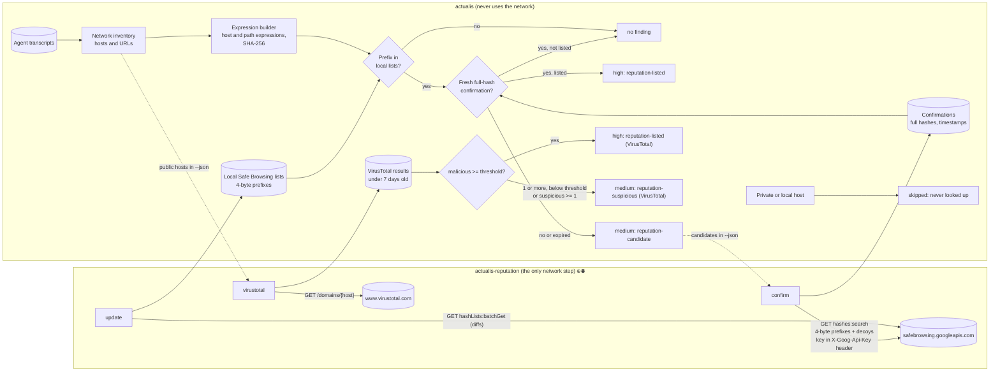
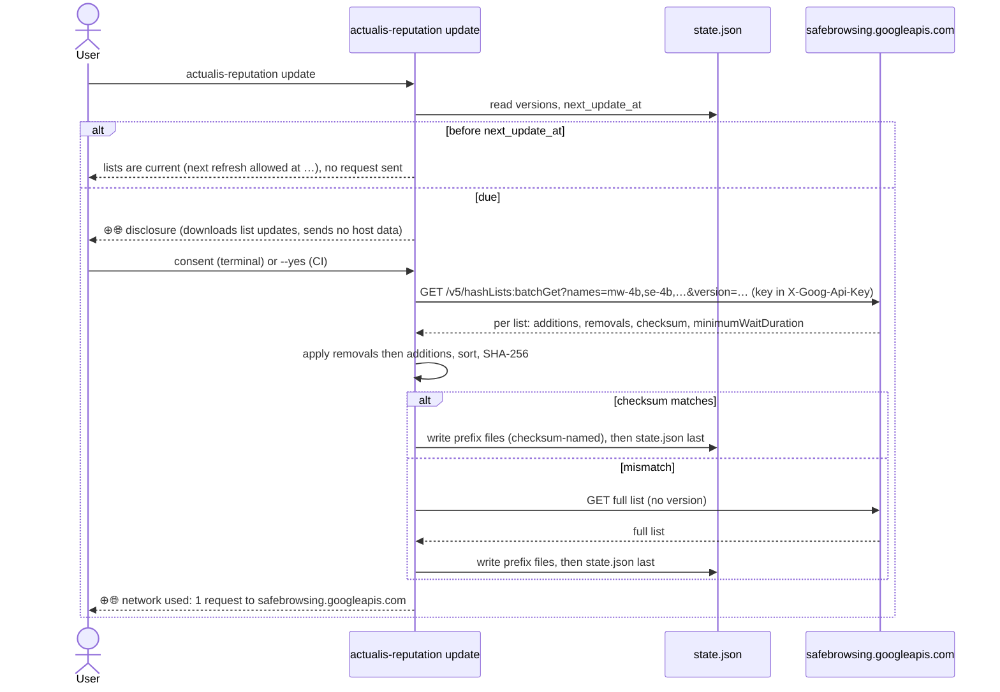
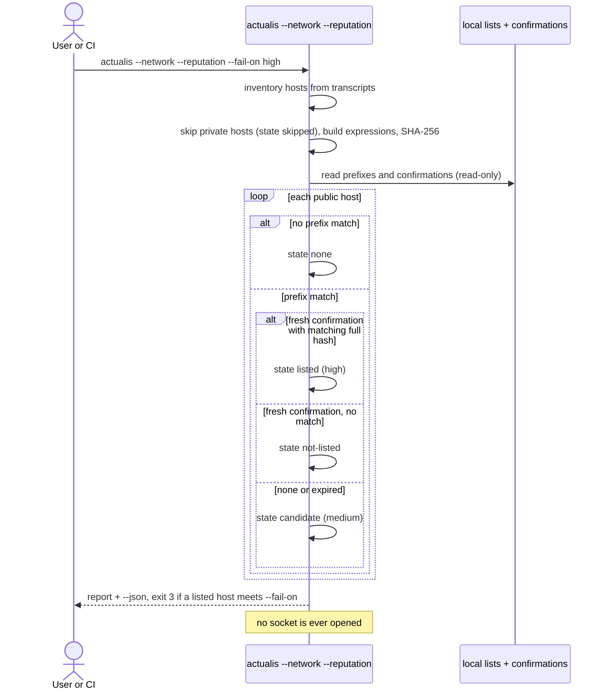
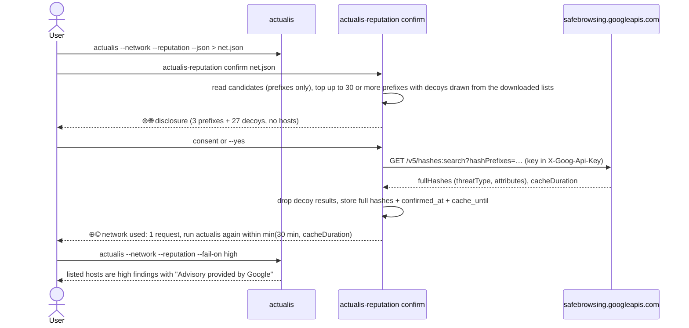
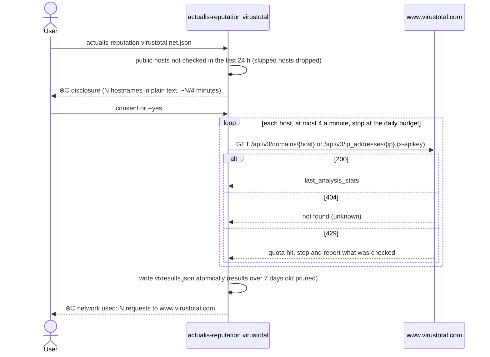
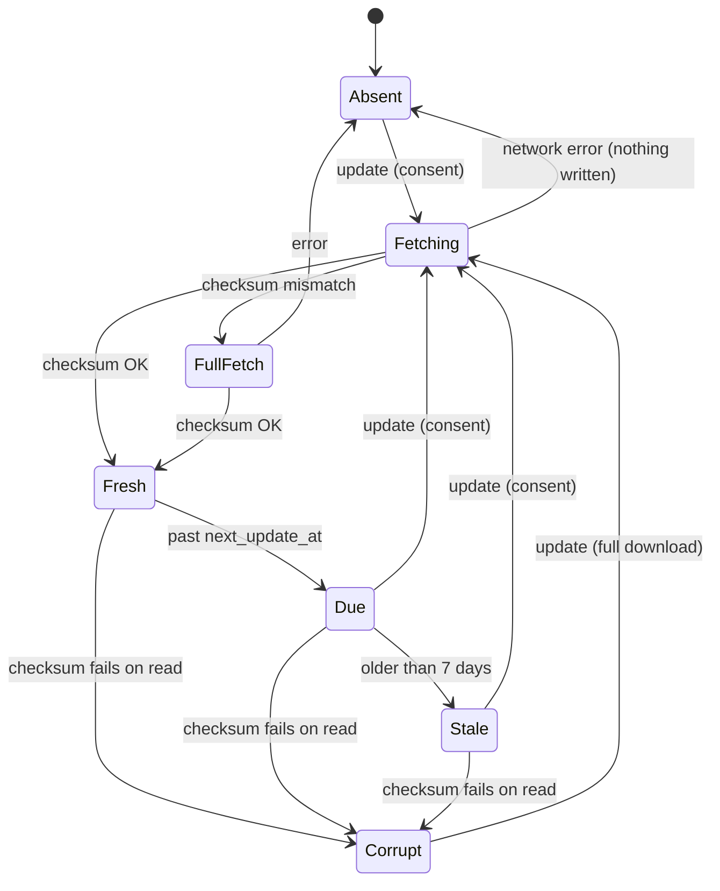
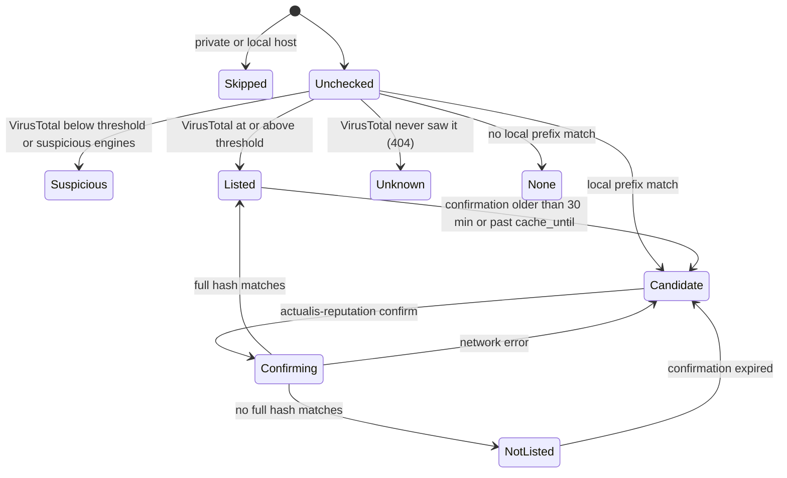
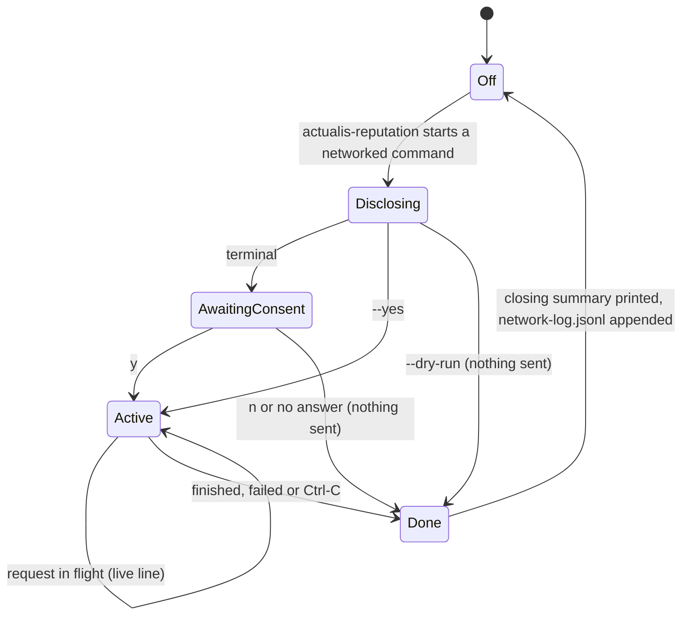

# Host reputation: Google Safe Browsing and VirusTotal


`actualis --reputation` tells you when a host your coding agents reached is on
a reputation list, and lets that fail a CI gate the way [`--ioc`](ioc.md) does.
It does this without giving up the property actualis is built on: **actualis
itself never uses the network.**

## What it is

Two programs, one direction of data flow.

- `actualis` reads your transcripts, builds the network inventory and matches
  it against files on your disk. It never opens a socket, and `actualis
  --self-check` proves its imports cannot.
- `actualis-reputation` is a separate command and the only part of actualis
  that uses the network. It does so only when you run it. It writes the
  reputation cache that `actualis --reputation` reads.

Everything the companion does is marked with `⊕🌐` (`[+net]` where the
terminal cannot show it, chosen by the same rule as actualis's other glyphs).
The mark appears on lines that report network use and nowhere else.

| Command | Uses the network | Sends |
|---|---|---|
| `actualis --network --reputation` | never | nothing |
| `actualis-reputation status` | never | nothing |
| `actualis-reputation forget` | never | nothing |
| `actualis-reputation update` | Google Safe Browsing | nothing about your hosts: it downloads list updates |
| `actualis-reputation confirm` | Google Safe Browsing | 4-byte hash prefixes of local matches, mixed with decoys |
| `actualis-reputation virustotal` | VirusTotal | hostnames, in plain text |

## Set up Google Safe Browsing

Google Safe Browsing is the default provider. You bring your own key.

1. Create a Google Cloud project (or pick one).
2. Enable the **Safe Browsing API** for it.
3. Credentials, then **Create credentials**, then **API key**.
4. **Restrict the key** to the Safe Browsing API (the key's "API restrictions"
   setting), so a leaked key can do nothing else.
5. Store the key in a password manager.

Give it to `actualis-reputation` in one of two ways:

```sh
export ACTUALIS_GSB_KEY=...                                  # environment variable
actualis-reputation update --key-command "op read op://Vault/Item/credential"
```

`--key-command` is preferred. The command runs without a shell and its output
is the key, so the key never sits in your shell history or in the environment
of every other process. A key is never accepted as an argument value.

A key must be 16 to 512 characters from `A-Z a-z 0-9 . _ ~ -`; anything else
is refused before a request is made. The Safe Browsing key travels in the
`X-Goog-Api-Key` request header, never in a URL, so it cannot end up in a proxy
log or an error message. Every string the program prints is also scrubbed of
the key.

## Set up VirusTotal (optional)

VirusTotal is an optional second opinion. It is online only, and **it sees
hostnames in plain text** and may keep them.

1. Create a VirusTotal account.
2. Copy the API key from your profile.
3. Provide it as `ACTUALIS_VT_KEY`, or with `--key-command`.

The free tier allows 4 requests a minute and 500 a day (counted by UTC date).
actualis-reputation throttles itself to 4 a minute, stops at the daily budget
and stops cleanly on an HTTP 429.

## Everyday use

```sh
actualis-reputation update                        # daily, or in CI
actualis --network --reputation                   # offline; no network is used
```

Once the lists are on disk, `actualis --network --reputation` matches every
host in the inventory against them. A match in the lists is only a
**candidate**. To turn a candidate into a verdict, confirm it with Google and
check again straight away:

```sh
actualis --network --reputation --json > net.json
actualis-reputation confirm net.json
actualis --network --reputation --fail-on high
```

A confirmation is usable for `min(30 minutes, Google's cacheDuration)`.
Google usually returns about 5 minutes, so run `confirm` and then the gate
immediately. `confirm` prints the actual window when it finishes, and warns
when Google gave none (such a result cannot mark a host listed).

For VirusTotal:

```sh
actualis-reputation virustotal net.json --vt-threshold 2
actualis --network --reputation --fail-on high
```

`--vt-threshold N` is the number of engines that must say "malicious" for a
`high` finding (default 2). It is stored with the results and kept until you
change it, so `actualis` needs no extra flag. A host is checked again after 24
hours; results older than 7 days are ignored and pruned.

Other commands:

```sh
actualis-reputation status    # lists, ages, confirmations, last network use
actualis-reputation forget    # delete the reputation cache (asks first; --yes skips)
```

### In CI

There is no terminal in CI, so a run that would send something needs `--yes`
(exit 2 otherwise, and a `--key-command` is not run for a refused run).

```yaml
- name: Host reputation
  env:
    ACTUALIS_GSB_KEY: ${{ secrets.ACTUALIS_GSB_KEY }}
  run: |
    actualis-reputation update --yes
    actualis --network --reputation --json > net.json
    actualis-reputation confirm net.json --yes
    actualis --network --reputation --fail-on high
```

Run `confirm` and the gate in the same job, one straight after the other: the
confirmation expires within 30 minutes and usually within about 5. Under
`--fail-on`, absent or corrupt lists exit 2 before anything is scanned, so a
gate cannot pass because its data was missing.

Safe Browsing and VirusTotal terms are for non-commercial use; see
[Licensing and attribution](#licensing-and-attribution).

## What is sent, and what is not

| Command | Sent |
|---|---|
| `update` | A list download request: the list names and the versions you already hold. Nothing about your hosts. |
| `confirm` | 4-byte SHA-256 prefixes of the candidates, plus decoy prefixes. Google never sees a host or URL. |
| `virustotal` | One hostname per request, in plain text. |

**Never sent, by any command:** URLs, paths, query strings, commands,
credentials, transcript text, or the key in a URL. `confirm` and `virustotal`
read only what `actualis --network --json` printed.

**Decoys.** Each `confirm` request carries at least 30 prefixes and at most
970 real ones (topped up to 30 with decoys). The decoys are drawn from the lists you downloaded, so they look like
real entries; random prefixes are used only to make up a shortfall.

**Hosts never looked up or sent.** These are skipped entirely: they are never
matched, never sent and show as state `skipped`.

- loopback, RFC 1918 private ranges (10/8, 172.16/12, 192.168/16) and
  link-local (169.254/16)
- carrier-grade NAT 100.64/10, `0/8`, `192.0.0/24`
- documentation ranges 192.0.2/24, 198.51.100/24, 203.0.113/24
- the benchmarking range 198.18/15
- multicast and reserved space, 224/4 and 240/4
- IPv6 literals
- single-label names (`buildhost`)
- names ending in `.local`, `.localhost`, `.internal`, `.home.arpa`, `.lan`,
  `.localdomain`, `.corp`, `.home`, `.intranet`, `.private`, `.test` or
  `.invalid`

Naming an internal system to a provider would say which systems your agents
touch, so these never leave your machine.

## Seeing network use

Every networked run prints a disclosure to stderr before the first byte is
sent:

```
⊕🌐 actualis-reputation uses the network.
  Provider  Google Safe Browsing v5, hash-prefix lookup
  Sends     4-byte SHA-256 prefixes for 3 candidates, mixed with 27 random decoys drawn from the downloaded lists.
            Google never sees a host or URL.
  Skips     12 private or local hosts
  Never     commands, paths, query strings, credentials, transcript text
  Key       $ACTUALIS_GSB_KEY (set, not shown)
```

- **Consent.** On a terminal it asks on every run, for example `Send 3
  lookups to Google? [y/N]`. Without a terminal it sends nothing unless you
  pass `--yes`, and exits 2 otherwise.
- **`--dry-run`** prints exactly what would be sent (the prefixes and decoy
  count, or the hostnames) and exits 0 without opening a connection. It reads
  no key, so a `--key-command` is not run.
- **A live line** such as `⊕🌐 sending 1 lookup(s) -> safebrowsing.googleapis.com`
  is printed while a request is in flight.
- **A closing line** is always printed, on success, failure and Ctrl-C:
  `⊕🌐 network used: 1 request to safebrowsing.googleapis.com, nothing else contacted`.
- **`--receipt FILE`** writes every request actually made (method, host, path,
  what was sent, status, bytes) as JSON, with the key removed.
- **`network-log.jsonl`** in the cache directory gets one line per run that
  attempted a request: time, command, provider, host contacted, request count.
  Never keys, hosts or prefixes.
- **`actualis --self-check`** says when the companion last used the network,
  read from that log.
- **The tray** shows a network badge while a networked command runs (it reads
  `in-flight.json`, which exists only while the command runs).

## How the verdicts work

Each host in the inventory gets one `reputation` state:

| State | Meaning | Finding | Gate |
|---|---|---|---|
| `none` | no expression's prefix is in any local list | none | |
| `skipped` | a private or local host; never looked up | none (counted) | |
| `candidate` | a prefix matched locally; no confirmation less than 30 minutes old | medium `reputation-candidate`: possible match, not confirmed; run `actualis-reputation confirm` | `--fail-on any` |
| `listed` | a confirmation less than 30 minutes old (and within its cache time) returned a full hash equal to one of the host's expression hashes, or VirusTotal's `malicious` count is at least `--vt-threshold` | high `reputation-listed` | `--fail-on high` |
| `not-listed` | a fresh confirmation, or VirusTotal, found nothing | none (counted) | |
| `suspicious` | VirusTotal: `1 <= malicious < threshold`, or `suspicious >= 1` | medium `reputation-suspicious` | `--fail-on any` |
| `unknown` | VirusTotal has never seen the host (HTTP 404) | none (counted) | |

`unknown` is not clean: it means no data. Likewise, a host with state `none`
is not proven safe.

**Why 30 minutes.** Google's terms allow a warning only after a full-hash
match from `hashes:search`, and only on information Google sent in the last 30
minutes. A prefix hit alone is never reported as unsafe. A confirmation older
than that, or past Google's `cacheDuration`, falls back to `candidate`.

**"Is currently listed."** The wording is hedged and time-stamped: a host
**is currently listed** or **may be** suspected malware. It does not say the
host was malicious when your agent reached it. The transcripts are historical
and the lists are not.

**Freshness.** The report header shows the list age, for example
`reputation: Google Safe Browsing lists from 2026-10-30 14:02 UTC, 3 h old`.
Lists older than 7 days raise a medium `reputation-stale` finding, because a
stale list cannot make a host listed on its own (a listing always needs a fresh
confirmation), but it can miss new threats and keep candidates for entries since
removed. `update` honours the
server's `minimumWaitDuration` (capped at 24 hours); if you run it too soon it
says `lists are current` and sends nothing.

## Architecture



## Sequences

### Refresh the lists



### Offline check (every run of actualis)



### Confirm candidates



### VirusTotal (online only)



## State machines

### Local list cache



`actualis` treats Absent and Corrupt as "no lists" (exit 2 with `--fail-on`),
Fresh and Due as usable, and Stale as usable plus a medium `reputation-stale`.
A `state.json` that does not name all five lists counts as Corrupt.

### One host



### The indicator



`Off` is the only state plain `actualis` is ever in.

## Cache files

Under `$XDG_CACHE_HOME/actualis/reputation/` (default
`~/.cache/actualis/reputation/`; on Windows `%LOCALAPPDATA%\actualis\reputation\`),
or the directory in `ACTUALIS_REPUTATION_DIR`. Directories are 0700 and files
0600. Only `actualis-reputation` writes them, atomically (temp file, fsync,
rename), and never through a symlink. `actualis` only reads.

The checksums detect corruption, not deliberate tampering: anyone who can write the
cache can replace the lists and `state.json` together. Protect the directory
with its 0700 mode.

| File | Contents |
|---|---|
| `gsb/state.json` | per list: `name`, `version` token, `sha256` of the sorted prefix set, `file`, `fetched_at`, `next_update_at`, `prefix_count`. Written last: it is the commit point |
| `gsb/<list>.<sha256[:16]>.prefixes` | the list's 4-byte prefixes, sorted, raw bytes. The name carries the first 16 hex digits of the checksum, so a crash mid-update leaves the old, consistent set. Checked against `state.json` on every read. Lists: `mw-4b`, `se-4b`, `uws-4b`, `uwsa-4b`, `pha-4b` |
| `gsb/confirmations.json` | per prefix: the full hashes Google returned with their threat types, `confirmed_at` and `cache_until`. No host names, no URLs |
| `vt/results.json` | the daily request count, the stored `vt_threshold` and, per host, `status` (`found` or `unknown`), the engine counts and `checked_at` |
| `network-log.jsonl` | one line per run that attempted a request |
| `in-flight.json` | `{pid, provider, started_at}`; exists only while a networked command runs (the tray badge) |

`actualis-reputation forget` deletes these files.

## Accuracy

Reputation lists are wrong in both directions.

- A **false positive**: a host is listed that is not harmful, for example a
  legitimate site that was compromised and has since been cleaned, or a shared
  host with one bad tenant.
- A **false negative**: a harmful host is not listed yet, or never will be.
  Lists lag new threats, and a stale local copy lags further.

A listing describes the host **now**, not when your agent reached it. "No
result" is not proof of safety. Treat a finding as a lead to look at, not a
verdict.

## Licensing and attribution

- **Google Safe Browsing API**: free for non-commercial use only. A free,
  open-source tool where each user brings their own key fits that. If you
  want to use it commercially, Google's product for that is
  [Web Risk](https://cloud.google.com/web-risk).
- **VirusTotal public API**: non-commercial use, 4 requests a minute and 500 a
  day, and it must not be used in commercial products or services. See
  [public versus premium API](https://docs.virustotal.com/reference/public-vs-premium-api).
- **Attribution.** Every Google-based result carries
  [Advisory provided by Google](https://developers.google.com/safe-browsing/v4/advisory)
  in the finding text, the report footer, the `--json` `advisory` field and
  the HTML report. It is never attached to VirusTotal results.
- **Threat types** (malware, social engineering, unwanted software,
  potentially harmful applications) are defined by Google:
  [ThreatType](https://developers.google.com/safe-browsing/reference/rest/v5/hashList#ThreatType).

## Troubleshooting

| You see | Cause and fix |
|---|---|
| `Safe Browsing answered HTTP 403: the key was rejected or the Safe Browsing API is not enabled for its project` | Enable the Safe Browsing API in the key's project, and check the key is restricted to that API and not another. |
| `Safe Browsing answered HTTP 401` | The key was rejected. Check the value. |
| `HTTP 429: quota reached` (Google) or `VirusTotal quota reached after N of M hosts` | You hit a quota. Try later; VirusTotal can resume where it stopped. |
| `lists are current (next refresh allowed at ...), no request sent` | Not an error. Google asked clients to wait; `update` honours it. |
| `--reputation: the lists in ... failed their check` | The cache is corrupt or was edited. Run `actualis-reputation update` again. |
| `--reputation: no Google Safe Browsing lists in ...` | Run `actualis-reputation update` first. With `--fail-on` this exits 2. |
| `nothing sent: there is no terminal to ask` | Running in CI or cron. Pass `--yes` to send or `--dry-run` to preview. |
| `no Google Safe Browsing key` / `the ... key is not shaped like an API key` | Set `ACTUALIS_GSB_KEY` or `--key-command`; the key must be 16 to 512 characters from `A-Za-z0-9._~-`. |
| `this report has no reputation data` | `confirm` needs the output of `actualis --network --reputation --json`. |
| `Google gave no cache time; this result cannot be used to mark a host listed` | Google returned no `cacheDuration`; re-run `confirm` later. |
| A proxy is needed | `HTTPS_PROXY` is honoured. |
