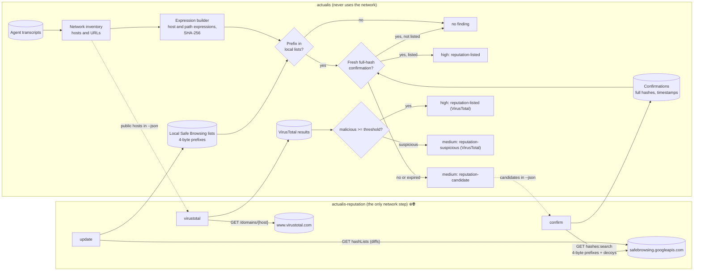
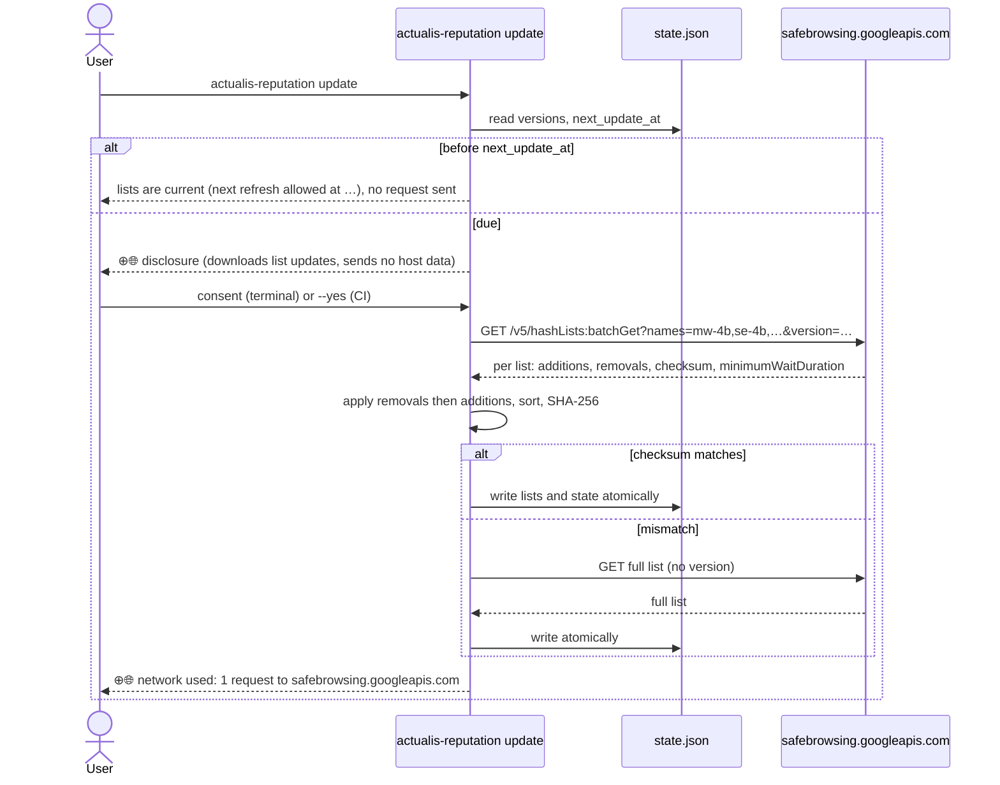
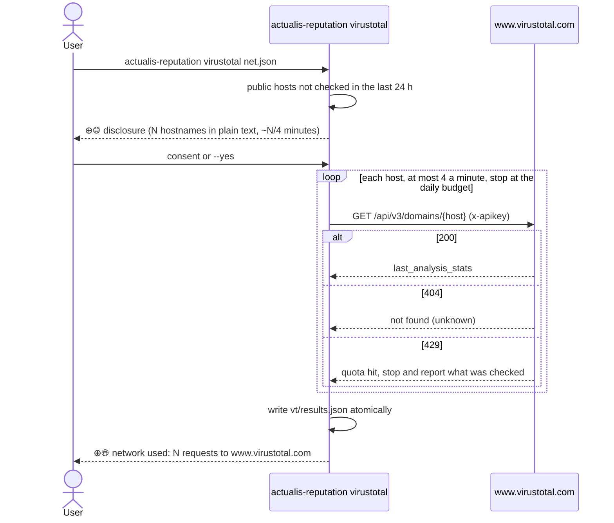
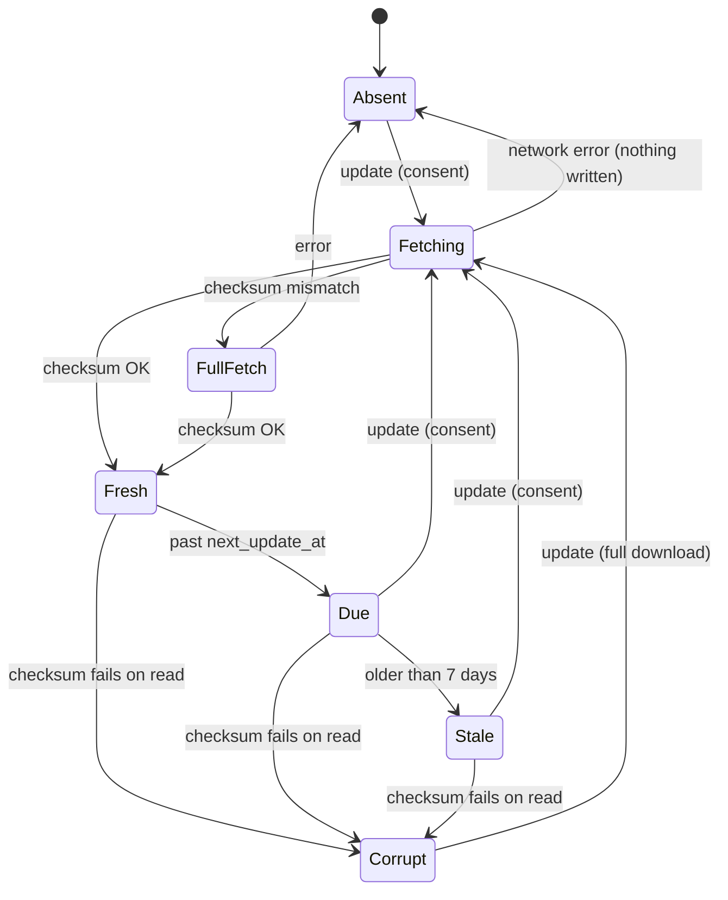
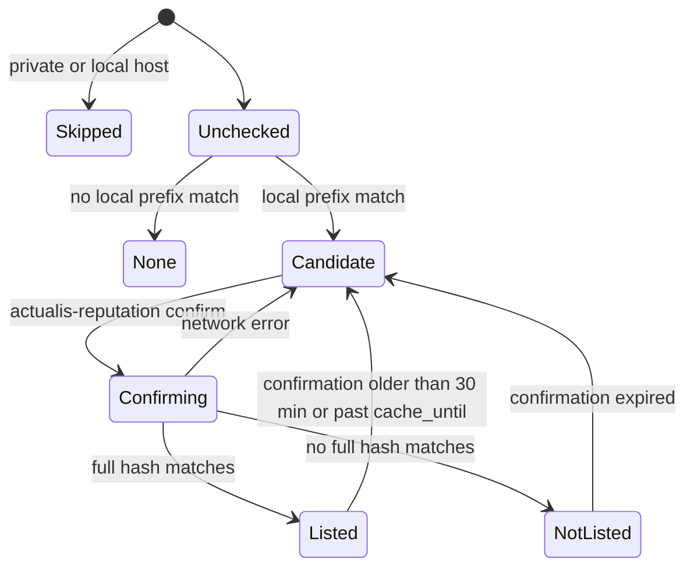
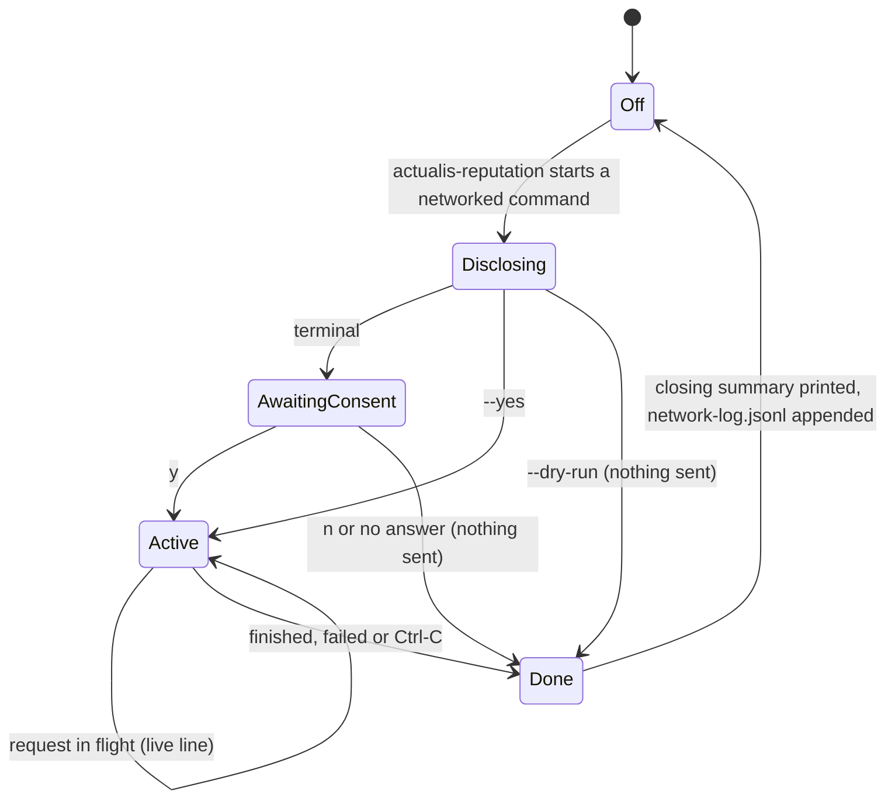

# Host reputation: Google Safe Browsing (offline by default) and VirusTotal

Status: design, for review. Date: 2026-10-30. Target release: 0.5.0.

## 1. Goal

Tell the user when a host their coding agents reached is on a reputation list,
and let that fail a CI gate the way `--ioc` does, without giving up the
property actualis is built on: **actualis itself never uses the network.**

- Google Safe Browsing is the default provider. Its threat lists are
  downloaded and checked locally; the network is used only to refresh the
  lists and, when the user asks, to confirm a local match by sending a 4-byte
  hash prefix.
- VirusTotal is an optional, online-only provider for users who want a second
  opinion and accept that it sees hostnames in plain text.
- Every network use is disclosed before it happens, shown while it happens,
  and recorded afterwards, the way iOS shows an indicator while an app uses
  location and lists what used it recently.

### Non-goals

- Submitting anything for scanning (no VirusTotal POSTs, no file uploads).
- Raw-URL lookups (`urls.search`, VirusTotal URL ids built from full URLs):
  they send the URL, and URLs carry tokens and internal paths.
- A commercial-use path. The Safe Browsing API and the VirusTotal public API
  are both for non-commercial use (section 9). A paid tier would need Google
  Web Risk and a VirusTotal premium licence, which is a separate design.
- Real-time checks while an agent runs. This is an after-the-fact audit.

## 2. Constraints

| Constraint | Consequence |
|---|---|
| `actualis.py` is one stdlib file and `--self-check` proves it imports nothing that can open a socket (`socket`, `ssl`, `http`, `urllib`, ...). It hand-rolls URL quoting to keep that claim. | All network code lives in a separate module, `actualis_reputation.py`, installed as a second console script. `actualis.py` gains only an offline matcher using `hashlib`, which it already imports. The import allowlist for `actualis.py` does not change. |
| Python 3.9+, standard library only. | The companion uses `urllib.request`, `ssl`, `json`, `hashlib`, `base64`. It gets its own import allowlist test. |
| Google: a warning may be shown only after a full-hash match from `hashes:search`, and only if Google sent that information within the past 30 minutes. Cache durations must be honoured. | A local prefix hit is never reported as unsafe. It is a **candidate**. A **listed** verdict needs a confirmation less than 30 minutes old (or within the returned cache duration, whichever is shorter). Older confirmations fall back to candidate. |
| Google: every Google-based warning carries "Advisory provided by Google" with a link, uses hedged wording ("suspected", "may"), and docs carry a false-positive and false-negative notice. | Built into the finding text, the report footer, `--json` and the docs. Never attached to VirusTotal results. |
| VirusTotal public API: 4 requests a minute, 500 a day; a 404 means "never seen", not clean. | The companion throttles to 4/min, stops at the daily budget, caches results, and reports a 404 as "unknown". |
| Keys must never be stored in the repo, a transcript, a log, a receipt or the cache, and never printed. | Keys come from an environment variable or a key command (section 6.4). The Safe Browsing key travels in the query string, so every error and receipt path scrubs it. |

## 3. Architecture



Two programs, one direction of data flow:

- `actualis` reads the transcripts, builds the network inventory and matches
  it against local files. It writes nothing to the reputation cache and never
  opens a socket.
- `actualis-reputation` writes the reputation cache. It reads only what
  `actualis --network --json` printed (hosts, prefixes of candidates) and its
  own cache; it never reads transcripts.

### 3.1 Components

| Unit | Lives in | Does | Depends on |
|---|---|---|---|
| Expression builder | `actualis.py` | Canonicalizes a host (and, where the inventory has one, a URL) and produces the Safe Browsing host/path expressions and their SHA-256 hashes. | `hashlib` |
| List reader | `actualis.py` | Loads the local prefix lists and confirmation file read-only, validates schema and checksums, refuses a corrupt or foreign file with a clear error. | `json`, `hashlib` |
| Reputation matcher | `actualis.py` | For each inventory host: no match / candidate / listed / not-listed, plus VirusTotal verdicts. Emits findings and `--json` fields. | the two above |
| List updater | `actualis_reputation.py` | `update`: fetches list diffs, applies them, verifies the checksum, honours `minimumWaitDuration`, writes atomically. | `urllib.request`, `ssl` |
| Confirmer | `actualis_reputation.py` | `confirm`: sends candidate prefixes (with decoys) to `hashes:search`, stores full hashes, threat types and `cacheDuration` with a timestamp. | same |
| VirusTotal client | `actualis_reputation.py` | `virustotal`: domain reports for public hosts, throttled, cached. | same |
| Disclosure and indicator | `actualis_reputation.py` | The disclosure block, consent, live indicator, closing summary and receipt (section 6). | none |
| Network-use log | `actualis_reputation.py` writes, `actualis` reads | A small append-only record of each network run (time, provider, host contacted, request count) so `actualis` and the tray can say when the network was last used. | `json` |

## 4. Data and file formats

All under `$XDG_CACHE_HOME/actualis/reputation/` (macOS and Linux default
`~/.cache/actualis/reputation/`; Windows `%LOCALAPPDATA%\actualis\reputation\`),
overridable with `ACTUALIS_REPUTATION_DIR`. Directory 0700, files 0600,
written by `actualis-reputation` only, atomically (write to a temp file in the
same directory, fsync, rename), never through a symlink.

| File | Contents |
|---|---|
| `gsb/state.json` | `schema: 1`, per list: `name`, `version` token, `sha256` of the sorted prefix set, `fetched_at`, `next_update_at` (from `minimumWaitDuration`), `prefix_count`. |
| `gsb/<list>.prefixes` | The list's 4-byte prefixes, sorted, raw bytes (4 × n). Checked against `state.json`'s checksum on every read. Lists: `mw-4b` malware, `se-4b` social engineering, `uws-4b` unwanted software, `uwsa-4b` unwanted software (Android), `pha-4b` potentially harmful applications. |
| `gsb/confirmations.json` | `schema: 1`, entries `{prefix, full_hashes: [{hash, threat_types, canary}], confirmed_at, cache_until}`. No host names, no URLs. |
| `vt/results.json` | `schema: 1`, entries `{host, stats: {malicious, suspicious, harmless, undetected, timeout}, status: found|unknown, checked_at}`. |
| `network-log.jsonl` | One line per run: `{at, command, provider, contacted: ["safebrowsing.googleapis.com"], requests, sent: "prefixes"|"hostnames"|"list-diff"}`. Never keys, hosts or prefixes. |

`actualis --network --json` gains, additively (schema_version stays 1):

- `network.items[].reputation`: `{state: "none"|"candidate"|"listed"|"not-listed", provider, threat_types, checked_at, advisory}` where `advisory` is `"Advisory provided by Google"` for Google results and absent otherwise.
- `network.reputation`: `{provider_lists: {name: fetched_at}, lists_age_hours, candidates: [{prefix_b64, expressions: n}], network_last_used: {at, provider}}`. Candidates carry prefixes only, so `actualis-reputation confirm` can read them without seeing hosts.

## 5. Behaviour

### 5.1 Expressions

For each host in the inventory (and each URL, when the inventory recorded one),
canonicalize as Safe Browsing specifies (lowercase, strip trailing dots, decode
percent-escapes repeatedly, collapse consecutive dots, normalise IPv4 forms to
dotted-quad; reuse actualis's existing host normalisation where it already
does this) and form the host expressions: the exact host, then up to four more
formed from the last five labels by removing leading labels, never the bare
TLD; paths: `/` for hosts, plus the path-prefix expressions for URLs (at most
six). Hash each `host + path` with SHA-256; the first 4 bytes are the prefix.
Private, loopback, link-local and `*.local`/`*.internal`/`*.localhost` hosts
are skipped entirely: they are never listed and never sent.

### 5.2 Verdicts and findings

| State | Meaning | Finding | Gate |
|---|---|---|---|
| none | no expression's prefix is in any local list | none | - |
| candidate | a prefix matched locally; no full-hash confirmation less than 30 minutes old | medium `reputation-candidate`: "possible match in Google Safe Browsing lists, not confirmed; run `actualis-reputation confirm`" | `--fail-on any` |
| listed | a confirmation less than 30 minutes old (and within `cache_until`) returned a full hash equal to one of the host's expression hashes, threat type not CANARY-only | high `reputation-listed`: "`evil.example` is currently listed by Google Safe Browsing as suspected malware (checked 14:02). Advisory provided by Google" | `--fail-on high` |
| not-listed | a fresh confirmation returned no matching full hash | none (counted) | - |
| VirusTotal found | `malicious >= --vt-threshold` (default 2) | high `reputation-listed` "flagged malicious by N VirusTotal engines (checked …)" | `--fail-on high` |
| VirusTotal suspicious | `malicious < threshold`, `suspicious >= 1` | medium `reputation-suspicious` | `--fail-on any` |
| VirusTotal unknown | 404 | none (counted as unknown) | - |

Wording is hedged and time-stamped: the verdict says the host **is currently
listed**, not that it was malicious when the agent reached it, because the
transcripts are historical and the lists are not.

`--reputation` turns the matcher on. Without it, `actualis` behaves exactly as
0.4.0. With it and no local lists, `actualis` prints one line explaining how to
run `actualis-reputation update` and exits 2 when `--fail-on` was also given
(a gate must not silently pass because the data was missing).

### 5.3 Freshness

The list age is shown in the report header (`reputation: Google Safe Browsing
lists from 2026-10-30 14:02, 3 h old`). Lists older than 7 days are reported as
stale (a medium `reputation-stale` finding) because a stale list can only miss
hits, never invent them. Confirmations older than 30 minutes, or past
`cache_until`, are ignored.

## 6. Making network use obvious

### 6.1 The mark

`⊕🌐` (ASCII fallback `[+net]`, chosen by the same rule as actualis's existing
glyph fallback). It appears on every line that reports network use and
nowhere else. A matching badge, the actualis mark with a small "+" and globe in
its corner, is used on actualis.app, the README section and the release card.
In the tray, the menu-bar icon carries the badge while `actualis-reputation`
runs.

### 6.2 Disclosure, before any request

Printed to stderr on every run, before the first byte is sent:

```
⊕🌐 actualis-reputation uses the network.
  Provider  Google Safe Browsing v5, hash-prefix lookup
  Sends     4-byte SHA-256 prefixes for 3 candidates, mixed with 27 random decoys.
            Google never sees a host or URL.
  Skips     12 private or local hosts
  Never     commands, paths, query strings, credentials, transcript text
  Key       $ACTUALIS_GSB_KEY (set, not shown)
```

For `update` the "Sends" line reads "nothing about your hosts: downloads list
updates (about N KB)". For VirusTotal: "37 hostnames in plain text to
VirusTotal, which may keep them. Free tier: about 10 minutes at 4 a minute."

### 6.3 Consent and dry run

- `--dry-run` prints exactly what would be sent (the list of hostnames for
  VirusTotal, the prefixes and decoy count for Safe Browsing) and exits 0
  without opening a connection.
- On a terminal, the first run of each provider asks `Send 3 lookups to Google? [y/N]`.
- Without a terminal (CI, cron), nothing is sent unless `--yes` is given.

### 6.4 Keys

`ACTUALIS_GSB_KEY` and `ACTUALIS_VT_KEY`, or `--key-command CMD` (run without a
shell, its stdout is the key; for example `op read op://Private/gsb/key`). A key
is never accepted as an argument value, never written anywhere, and scrubbed
from every exception message, receipt and log line (the Safe Browsing key is in
the request URL, so the scrubber runs on every string that could contain it).

### 6.5 Indicator and record

```
⊕🌐 sending 3 lookups → safebrowsing.googleapis.com
⊕🌐 network used: 1 request to safebrowsing.googleapis.com, nothing else contacted
```

The live line exists only while a request is in flight. The closing line is
printed on success, failure and Ctrl-C. `--receipt FILE` writes every request
actually made (method, host, path, prefix count or hostnames, status, bytes),
with the key removed. `actualis --self-check` gains a line: "network: actualis
never uses it; actualis-reputation last used it 2026-10-30 14:02 (Google Safe
Browsing)", read from `network-log.jsonl`.

## 7. Sequences

### 7.1 Refresh the lists



### 7.2 Offline check (every run of actualis)

```mermaid
sequenceDiagram
  actor U as User or CI
  participant A as actualis --network --reputation
  participant L as local lists + confirmations
  U->>A: actualis --network --reputation --fail-on high
  A->>A: inventory hosts from transcripts
  A->>A: skip private hosts, build expressions, SHA-256
  A->>L: read prefixes and confirmations (read-only)
  loop each public host
    alt no prefix match
      A->>A: state none
    else prefix match
      alt fresh confirmation with matching full hash
        A->>A: state listed (high)
      else fresh confirmation, no match
        A->>A: state not-listed
      else none or expired
        A->>A: state candidate (medium)
      end
    end
  end
  A-->>U: report + --json; exit 3 if a listed host meets --fail-on
  Note over A: no socket is ever opened
```

### 7.3 Confirm candidates

```mermaid
sequenceDiagram
  actor U as User
  participant A as actualis
  participant R as actualis-reputation confirm
  participant G as safebrowsing.googleapis.com
  U->>A: actualis --network --reputation --json > net.json
  U->>R: actualis-reputation confirm net.json
  R->>R: read candidates (prefixes only), add random decoys
  R-->>U: ⊕🌐 disclosure (3 prefixes + 27 decoys, no hosts)
  U->>R: consent or --yes
  R->>G: GET /v5/hashes:search?hashPrefixes=…
  G-->>R: fullHashes (threatType, attributes), cacheDuration
  R->>R: drop decoy results, store full hashes + confirmed_at + cache_until
  R-->>U: ⊕🌐 network used: 1 request; run actualis again within 30 minutes
  U->>A: actualis --network --reputation --fail-on high
  A-->>U: listed hosts are high findings with "Advisory provided by Google"
```

### 7.4 VirusTotal (online only)



## 8. State machines

### 8.1 Local list cache



`actualis` treats Absent and Corrupt as "no lists" (exit 2 with `--fail-on`),
Fresh and Due as usable, Stale as usable plus a medium `reputation-stale`.

### 8.2 One host



### 8.3 The indicator



`Off` is the only state plain `actualis` is ever in.

## 9. Licensing and attribution

- Safe Browsing API: free, non-commercial use only. A free, open-source tool
  where each user brings their own key fits. The docs say so plainly, and
  point commercial users at Google Web Risk.
- VirusTotal public API: non-commercial, 4/min and 500/day; "must not be used
  in commercial products or services". The docs say so and link the terms.
- Google attribution "Advisory provided by Google" (linked) on every Google
  result: finding text, report footer, `--json` `advisory`, HTML report.
  Threat types link to Google's definitions. The docs carry the false-positive
  and false-negative notice. Never on VirusTotal results.

## 10. Threat model

| Threat | Mitigation |
|---|---|
| A host list leaks which internal systems the user's agents touch | Safe Browsing gets only 4-byte prefixes, mixed with decoys; private hosts are never sent; VirusTotal (plain hostnames) is opt-in with a blunt disclosure. |
| A credential in a URL reaches a provider | Hosts only; URLs are never sent; prefixes are one-way. |
| The API key leaks | Env or key command only; scrubbed from errors, receipts, logs and `--json`; never an argument value. |
| A tampered local list hides a host or invents one | Checksum on every read; a mismatch is Corrupt (no lists, exit 2 under `--fail-on`); writes are atomic, 0600, no symlinks; confirmations cannot create a verdict without a local prefix match and a matching expression hash. |
| A malicious or compromised network path | HTTPS with certificate verification (`ssl.create_default_context`), host pinned to the two provider hostnames, response size caps, JSON schema validation; a bad response writes nothing. |
| A silent network call | Only `actualis-reputation` can make one; `actualis --self-check` keeps proving the core imports no networking module; every run is disclosed, consented, indicated and logged. |
| A stale list gives false comfort | Age in the header; `reputation-stale` after 7 days; docs state lists can miss new threats. |

## 11. CLI summary

```
actualis --network --reputation [--fail-on LEVEL]      offline check (never networks)

actualis-reputation update      [--yes] [--dry-run] [--receipt FILE] [--key-command CMD]
actualis-reputation confirm  NET.json [--yes] [--dry-run] [--receipt FILE] [--key-command CMD]
actualis-reputation virustotal NET.json [--vt-threshold N] [--yes] [--dry-run] [--receipt FILE]
actualis-reputation status      lists, ages, last network use; never networks
actualis-reputation forget      delete the reputation cache
```

Exit codes follow actualis: 0 done, 1 runtime error (network, quota), 2 usage
error (no key, refused combination, no consent without a terminal).

## 12. Testing

- Offline: synthetic prefix lists and confirmations built in the tests (the
  hash of an invented host such as `malware.test.invalid` placed in a list);
  every state in 5.2 and 8.2, freshness boundaries (29/31 minutes, 7 days),
  corrupt files, symlinks, permissions, private-host skipping, expression
  generation against the canonicalization examples in Google's docs.
- The companion against a local fake HTTPS server (stdlib `http.server` + a
  test certificate, in the tests only): list diffs with additions, removals,
  checksum mismatch, `minimumWaitDuration`, `hashes:search` with decoys,
  VirusTotal 200/404/429 and throttling; the key never appears in any output,
  receipt, log or exception.
- Disclosure, consent, `--dry-run` (no connection opened: the fake server
  asserts zero requests), CI without `--yes`, Ctrl-C closing line.
- `actualis --self-check` still proves `actualis.py` imports no networking
  module; a test asserts `actualis.py` never imports `actualis_reputation`.
- Manual acceptance on the maintainer's machine with a real Safe Browsing key
  (and a VirusTotal key): `update`, a candidate from Google's published test
  URL pattern if one exists in the lists, `confirm`, the gate, the receipt and
  the indicator; the key supplied through `--key-command` so it never enters
  the shell history or the session.

## 13. Documentation and release

- README: a section "Optional: host reputation (uses the network)" with the
  `⊕🌐` mark, the offline-by-default model, the three commands, the disclosure
  example and links.
- `docs/reputation.md`: setup for each provider (Google Cloud project, enable
  the Safe Browsing API, create a key restricted to it; VirusTotal account and
  key), what is and is not sent, the diagrams from this spec, freshness, the
  false-positive and false-negative notice, licensing, troubleshooting.
- README's "No network" claim becomes: "actualis never uses the network. The
  optional `actualis-reputation` command does, only when you run it, and tells
  you what it sends."
- CHANGELOG 0.5.0, actualis.app release page, and a community-voice LinkedIn
  post drafted for the maintainer to publish.
